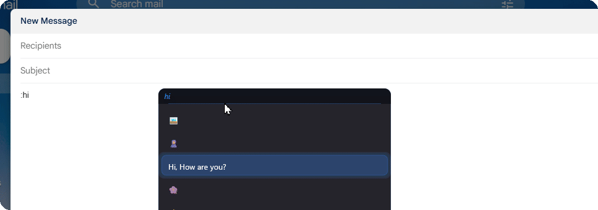

<picture>
  <source media="(prefers-color-scheme: dark)" srcset="https://readme-typing-svg.demolab.com?font=Fira+Code&pause=1200&color=F8FAFC&center=true&vCenter=true&width=650&lines=I+build+tools+that+fix+annoyances;Desktop+apps+%26+backend+APIs;C%2B%2B+%C2%B7+C%23+%C2%B7+Python+%C2%B7+AI+Evaluation" />
  
</picture>

  

---

## About

I'm a backend and systems engineer in Dhaka, Bangladesh. Most of what I build starts with an annoyance I face daily, and ends when that annoyance is gone. I care about small binaries, low idle cost and no manual.

- **EX-Expander**: type a shortcode in any app and pick the expansion from a popup. No focus stealing, ~3 MB native build.
- **LingoLens**: snip a region of the screen and read the translation in place, over the original text.
- **Left Right Audio Balancer**: two volume sliders for one output device, so left and right can be set separately. Also fixes Bluetooth headsets that report only one channel.

I have an AI-evaluation background across RLHF, tool-calling and multilingual projects, so I know how models fail and how to test for it.

Open to backend and systems roles, including AI evaluation work.

---

## Featured Projects

### [EX-Expander](https://github.com/srnafi/EX-Expander) 

A system-wide text expander for Windows. Type a shortcode in any app, pick from the popup, and the expansion is inserted without stealing focus. You don't have to memorize your own shortcuts.

- ~3 MB native download, ~3% CPU while in active use
- Low-level keyboard hooks, so it works in browsers, editors and games
- GPU-rendered popups (Direct2D) that never take focus
- Per-app scoping, custom trigger characters, auto-start on login
- Clipboard-safe insertion, plus a WebView2 manager for adding and editing expansions

    

  
   Type :hi, pick from the popup, inserted anywhere

### [LingoLens](https://github.com/srnafi/LingoLens)

OCR screen translator. Press <kbd>Alt+Shift+M</kbd>, drag a box over any on-screen text, and the translation renders over the original.

- Persistent Flask + EasyOCR backend loads models once, so snips are instant across 20+ languages
- 55% faster OCR through image preprocessing
- Tiered translation fallback (Google, deep-translator, MyMemory) so a snip doesn't fail
- Dark PyQt5 control center for languages, colors, opacity and fonts

     

### [Left Right Audio Balancer](https://github.com/srnafi/left-right-audio-balancer) 

Per-ear volume controller for Windows 10 that sits on your desktop as a widget. The setting exists in Control Panel, several dialogs deep, which makes it useless for anything you adjust more than once. This puts both channels on a desktop card.

- Linked mode holds the offset between the ears, so a balance you set survives the next volume change. Master scales both without breaking it
- Detects Bluetooth headsets that report a single channel, and fixes it by disabling AVRCP absolute volume. The registry write needs admin rights, and the app reads the key back to confirm it landed
- .NET 10 and WPF, single self-contained executable
- Does not disappear on "win + D" press, unlike most win 10 widget apps out there.

    

---

## Most-used languages

<picture>
  <source media="(prefers-color-scheme: dark)" srcset="https://github-readme-stats.vercel.app/api/top-langs/?username=srnafi&layout=compact&theme=github_dark&hide_border=true&card_width=450" />
  
</picture>

---

## Tech Stack

| | |
|---|---|
| **Languages** | C# · C++ · Python · JavaScript / TypeScript · Java · C · Shell · Lua |
| **Backend** | Node.js · Express · Flask · FastAPI · REST APIs · JWT / RBAC |
| **Databases** | MongoDB · PostgreSQL · SQLite |
| **Systems & Desktop** | Win32 API · Direct2D · WebView2 · .NET / WPF · PyQt5 · Electron |
| **Vision / ML tooling** | OpenCV · EasyOCR · OpenVINO |
| **Tools & Frontend** | Git · Docker · Linux · React |

       

---

## AI Evaluation Background

- **RWS TrainAI**: 5,000+ multilingual evaluation and annotation tasks (Jan 2025 – Aug 2026)
- **Outlier (Scale AI)**: 400+ assignments in LLM evaluation, adversarial prompting, RLHF and tool-calling, plus reviewing other contributors' work (Oct 2024 – Feb 2026)
- Completed RWS Linguistic AI certification training (machine translation, NMT, LLMs, MT evaluation)

